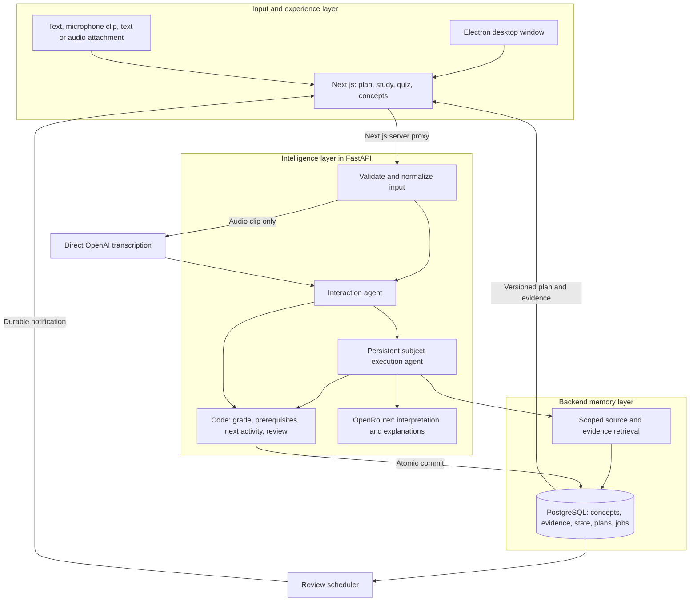

# Loke: desktop learning intelligence MVP

Horizontal ownership is selected. The desktop/Input layer belongs to A, Intelligence to B, and Backend Memory to C. A runnable starter scaffold now lives in layers/input, layers/intelligence and layers/memory, with shared contracts. The remainder of this document is the weekend MVP specification, not a claim that every feature is implemented.

## Decisions and assumptions

Build a desktop learning partner for an undergraduate learning **neural signaling**. The intelligence layer creates a short study plan, tracks timestamped evidence, chooses a prerequisite check or review, adapts the next activity after answers, and sends an opt-in review reminder without another learner prompt.

Keep the OpenPoke stack: **Next.js/React, Python 3.11, FastAPI, Pydantic, OpenRouter, persistent subject agents and a trigger scheduler**. Add a thin Electron desktop window. Keep PostgreSQL for structured evidence and the concept graph. Direct OpenAI file transcription handles microphone recordings/audio uploads. Reuse selected OpenPoke modules rather than rebuilding their plumbing; replace email-specific behavior and unbounded history with learning-specific contracts.

Assume three teammates familiar with Python and React, one consenting adult learner, English, and approximately 45 total person-hours. Work Saturday October 17, 2026, 09:00 to 19:00, and Sunday October 18, 09:00 to 17:00, Asia/Shanghai, with meals and breaks. Demo locally on one laptop, with provider APIs available. Native installer distribution, signing and cloud deployment are not weekend requirements.

**Demo proof:** the app selects a useful next step without being asked, explains the evidence behind it, incorporates an answer immediately, remembers it after restart, and later delivers a scheduled review. The desktop interface must make these decisions comprehensible. Calling the product an intelligence layer does not establish that it diagnoses gaps or estimates retention accurately.


### Current scaffold status

The starter includes a deterministic learning loop, separate records for evidence/current state/sources/plans/jobs, shared generated contracts, Next.js/Electron shell, optional provider adapters and single-worker review scheduling. Default demo mode uses SQLite because the host Docker daemon is not running. PostgreSQL configuration is included but is not yet integration-tested. Live provider calls require keys and have not been exercised. Active-quiz suppression, snooze, full plan completion, explicit model citation validation, versioned migrations/job leases and packaged desktop distribution remain next tickets. See each layer README; do not treat all acceptance boxes below as completed.

## 1. MVP definition and scope

**Product:** Loke is a desktop learning partner that remembers a learner's goal and evidence, identifies a useful question or prerequisite to check, and proactively organizes their next study and review activities.

The product has three logical layers, not three separately deployed services:

| Layer | Responsibility | Does not own |
| --- | --- | --- |
| Input and experience | Desktop UI; goal/chat; microphone; attachments; quizzes; diagrams/resources; reminder controls and rendering | Grading truth, learner-state mutation or recommendation policy |
| Intelligence | Interaction/execution agents; concept association; prerequisite checks; evidence interpretation; activity selection; bounded lesson-plan updates | Raw media retention, browser secrets or direct arbitrary database writes |
| Backend memory | Canonical concepts/relations; immutable events; current projections; source chunks; scoped retrieval; durable jobs and transactions | Independent teaching decisions or a second learner profile |

LLM access and RAG orchestration run in the FastAPI intelligence code. Source documents and retrieval records live in memory storage. Putting the model in a box labeled “memory” does not make its output stored evidence.

| Weekend commitment | Later vision |
| --- | --- |
| Local Electron desktop window showing a Next.js interface | Distributed/signed desktop app, smart glasses, VR, cross-platform SDK |
| Text, microphone clip and text/audio attachments | Arbitrary PDFs, OCR, images, long recordings and continuous live voice |
| One subject, six concept nodes, eight reviewed quiz cards | General subjects and dynamically discovered curricula |
| MCQ and constrained fill-in-the-blank quizzes | Code execution, simulations and arbitrary essay grading |
| Short explanations, one reviewed SVG diagram, curated resource links | AI-generated images/videos and open-web resource discovery |
| Three-step study plan, prerequisite diagnostic and opt-in timed review | Validated knowledge-gap diagnosis and forgetting estimates |
| Evidence-linked memory with immediate state updates | Automatic hierarchical topic-agent splitting and large-scale semantic retrieval |
| In-app reminders while backend runs | SMS reminder delivery, direct phone calls and background delivery with the app closed |

The earlier phone-first plan is superseded. SMS/audio messages/direct calls remain potential secondary channels. A Twilio SMS reminder is a stretch only if an approved sender already works and core acceptance checks pass by Sunday noon. Do not spend the weekend provisioning iMessage infrastructure or telephony. A contact displayed in Apple's Messages is not evidence of native iMessage integration.

Let the learner request text, diagram or audio input/output preferences. Do not infer an immutable “learning style” or claim that choosing an auditory/visual mode improves outcomes. The intelligence policy adapts to observed answers, stated preferences and available activities.

### UI direction

Use a restrained Apple-like workspace. Tokens: background `#F5F5F7`, surface `#FFFFFF`, main text `#1D1D1F`, secondary `#6E6E73`, accent `#007AFF`, border `#D2D2D7`. System sans-serif for headings/body, system monospace for compact technical labels. Heading 28 px, body 16 px, supporting text 13 px; spacing in 8 px increments, restrained 12 px corners, visible keyboard focus.

Use a narrow sidebar with Today, Study and Concepts. The main area shows one current activity; a collapsible right panel explains related concepts, sources and “Why this next?” The signature element is a next-activity card with evidence and prerequisite chips. Avoid a graph canvas occupying the whole screen or a wall of mastery meters.

```text
+----------------+-----------------------------------+--------------------+
| Loke           | Today: Neural signaling           | Why this next?     |
| Today          | Goal and 3-step study plan        | Missed item E2     |
| Study          |                                   | Prerequisite link  |
| Concepts       | One explanation or quiz card      | Related concepts   |
|                |                                   | Reviewed resources |
|                | Text / Record / Attach            |                    |
+----------------+-----------------------------------+--------------------+
```

Empty state asks for one goal. Quiz submit/feedback is keyboard accessible and never relies on color alone. Recording has an explicit start/stop indicator; transcript is editable before sending. Show save/loading/error states accurately. Sidebar navigation and focus survive updates. Treat UI polish as a required integration pass, not optional work after the engine is finished.

## 2. Demo script

Target four to five minutes. The learner wants to understand how neurons release neurotransmitters and reports confidence in action potentials. That confidence is a report, not proof. Use actual stored event IDs and a visible demo clock for the later reminder.

| Time | Learner action | System behavior without extra prompting |
| --- | --- | --- |
| 0:00 | Open desktop app, accept seven-day demo storage, set goal and 10-minute study budget | Create the neural-signaling agent and a three-step plan: check a relevant prerequisite, practice signaling, connect it to transmitter release. Show one current activity and why. |
| 0:35 | Record: “I studied action potentials. I think potassium entering causes depolarization.” | Transcribe, allow transcript correction, then commit study-report E1. Tag the report as action-potential-related without declaring mastery. |
| 1:00 | Answer MCQ: rapid rising phase, A K+ leaves, B Na+ enters. Choose A | Code grades incorrect, records E2, updates current concept state and review due time atomically. Explain B and revise the plan automatically. |
| 1:35 | Observe next-activity card | App offers a resting-potential check, linked to ionic gradients/selective permeability: “This supports action potentials; we have not checked it yet.” This is a suggested diagnostic, not a claim that a hidden gap is proven. No WHAT NEXT prompt is needed. |
| 2:00 | Complete a constrained prerequisite question | Record E3, update the plan and show why the next step changed or stayed the same. A correct item yields narrow evidence, not validated mastery. |
| 2:30 | Attach a short `.md` study note, then request an explanation | Retrieve at most two relevant source chunks, show attachment provenance and a reviewed textbook link. Open the fixed neural-signaling diagram and related concept list. Reading/uploading does not mark concepts learned. |
| 3:10 | Finish or dismiss any started quiz; operator restarts app/backend, leaving database intact | Reopen the same goal, agent, evidence and plan revision. The knowledge panel shows E2/E3-backed state, not reconstructed vague chat memory. |
| 3:40 | Operator visibly advances test clock to +24 hours | Scheduler creates one due-review notification without learner input. Card says “Review due: action-potential phases” and cites E2. Click begins the queued review. No claim that the learner has already forgotten it. |
| 4:20 | Presenter inspects “Why this next?” | Show reason codes, evidence IDs, prerequisite edge and unchanged subject agent ID. Explain the clock simulation and the distinction between report, assessment and inference. |

Real review remains due 24 hours after E2. The test clock is isolated from wall-clock mode and visibly labeled “Demo clock”; do not backdate evidence or silently change real schedules. The demo is proactive at event time and scheduled review time, not continuously generating new model calls in the background.

If microphone permission/transcription fails, type the report. If Electron launch fails, use the identical Next.js app in a browser and label the desktop wrapper failed. Neither workaround counts as passing the failed native/microphone check. No live call is required for this script.

## 3. Architecture and OpenPoke reuse

Start from a pinned OpenPoke snapshot and record the commit in a reuse manifest when implementation begins. Preserve its copyright/license notices in copied portions. OpenPoke's [repository](https://github.com/shlokkhemani/openpoke) uses FastAPI, OpenRouter, Next.js and a scheduler; its [MIT license](https://github.com/shlokkhemani/openpoke/blob/main/LICENSE) permits reuse with the stated notice requirement.

| OpenPoke asset | Planned reuse | Learning-specific changes |
| --- | --- | --- |
| `web/` Next.js shell and API proxy | Reuse HTTP plumbing and project organization | Replace email/chat presentation with study-plan, quiz and evidence UI |
| `server/` FastAPI application/config | Reuse bootstrap and shared environment conventions | Add learner, learning-input, quiz, plan and notification routes |
| OpenRouter client and interaction runtime | Reuse client/parsing/error plumbing after smoke test | Typed outputs, learner-scoped context, one topic handoff, bounded calls |
| Execution-agent role/history organization | Reuse role construction and history interfaces | Store structured events/current state; replace email tools with learning proposals |
| `server/services/trigger_scheduler.py` | Reuse poll/due-dispatch structure | Durable, opt-in review jobs; deterministic eligibility; deduplicated delivery |
| Gmail/Composio tools and email watchers | Remove from active dependency/config path | No Gmail credentials required for the demo |
| Full-roster/raw-history behavior and unrestricted loops | Replace | Retrieve one subject, bounded evidence; authoritative writes in code |

The [interaction runtime](https://github.com/shlokkhemani/openpoke/blob/main/server/agents/interaction_agent/runtime.py), [execution log store](https://github.com/shlokkhemani/openpoke/blob/main/server/services/execution/log_store.py) and [scheduler](https://github.com/shlokkhemani/openpoke/blob/main/server/services/trigger_scheduler.py) are concrete reuse candidates. The current scaffold adapts the OpenRouter client, Next.js API proxy and scheduler lifecycle. The source snapshot and retained notices are recorded in third_party/openpoke/REUSE.md; other reuse entries remain planned work. Avoid copying all of OpenPoke's functionality simply because it starts successfully.



**Synchronous path:** local HTTP input validates consent/size/source IDs, resolves the selected subject, retrieves bounded context, grades or obtains a model proposal, then commits learning events, projections, plan and review job in one transaction. Return `state_revision` and `plan_revision` only after commit. Audio is first transcribed and confirmed by the learner. Do not hold a database transaction open during an API call.

**Deferred path:** scheduler polls every 30 seconds in normal mode, claims due jobs, checks current consent/evidence and creates one durable in-app notification. When due eligibility changes, it revises the plan with a review activity and increments plan revision; it does not create a new correctness assessment. The UI polls committed state/notifications every two seconds; no SSE infrastructure is required. A read/poll never creates another reminder or plan. Expiry cleanup runs hourly. Scheduler needs no LLM call to decide whether a review is due.

**Desktop boundary:** Electron loads the localhost Next.js server; Next.js proxies only allowed learning API routes to localhost FastAPI. Keep both servers running for the demo and shut down children cleanly. Use `next build`/`next start`, not a static export that loses the proxy route. A native installer is deferred. [Next.js self-hosting](https://nextjs.org/docs/app/guides/self-hosting), [Electron BrowserWindow](https://www.electronjs.org/docs/latest/api/browser-window).

Keep Node integration off in the renderer, context isolation/sandbox on, and the preload API minimal. Open approved resource links in the external browser. No unrestricted shell/file access or API keys in renderer/public environment variables. [Electron security guidance](https://www.electronjs.org/docs/latest/tutorial/security).

Core reminders work only while FastAPI runs. If everything closes, process overdue jobs when it starts again and label them overdue. Optional native OS notifications can mirror an in-app notification after permission; the in-app notification remains authoritative. No claim of delivery while the laptop sleeps or the backend is stopped.

## 4. Intelligence, agent boundaries and memory growth

### Current memory rather than one long-term blob

Separate five categories: learner goal/preferences; canonical concept/prerequisite graph; timestamped learning evidence; versioned current concept state; source material plus current plan/review jobs. Chat history supplies context, not the sole learner-state database. Agent summaries are optional caches with a recorded last-event ID, never the source of truth.

Each learning event is appended once. In the same transaction, code folds it into `concept_state`, increments learner state revision, updates the relevant plan and invalidates stale review jobs. Reads include state revision, plan revision and graph version. If a model proposal's base versions changed before commit, recompute the deterministic decision or discard the proposal. The UI rejects older state/plan responses arriving after newer ones. Restart can replay events to rebuild the projection.

Evidence is scoped and linked. A learner report remains reported; a quiz response is observed; deterministic grading applies to that card only; model hypotheses stay inferred. State labels are `unassessed`, `attempted`, `needs_practice`, `recent_unassisted_correct` and `review_due`. A due timer means practice is scheduled, not that forgetting has been measured.

### Concept graph, similarity and RAG

Seed six reviewed concepts: ionic gradients, selective permeability, resting membrane potential, action-potential phases, presynaptic calcium entry, and transmitter release. Store `prerequisite_of` and `related_to` edges separately by type. Reviewed prerequisite edges are acyclic. An LLM can propose an edge for later review; it cannot silently turn similarity into a prerequisite.

| Canonical concept ID | Label | Authored prerequisite targets |
| --- | --- | --- |
| `ionic_gradients` | Ionic gradients | `resting_potential` |
| `selective_permeability` | Selective permeability | `resting_potential` |
| `resting_potential` | Resting membrane potential | `action_potential_phases` |
| `action_potential_phases` | Action-potential phases | `presynaptic_calcium_entry` |
| `presynaptic_calcium_entry` | Presynaptic calcium entry | `transmitter_release` |
| `transmitter_release` | Transmitter release | None |

These are the demo's reviewed teaching dependencies, not a universal claim that every learner must follow this sequence. `ionic_gradients` and `selective_permeability` also have a related edge. UI labels can vary; canonical IDs cannot vary between slices.

Associate input using canonical IDs/aliases first. Otherwise rank the small concept set by normalized token overlap, and let one schema-constrained topic call choose among at most three candidates or return ambiguous. Enforce known IDs. Similarity is a retrieval aid, not a learning-state update. No embeddings/Neo4j requirement for six nodes; cosine/vector retrieval is a later replacement for the lookup interface.

For a `.txt`/`.md` attachment, split text into paragraph chunks capped at about 1,200 characters with source ID, title, concept tags and content hash. Retrieve the top two chunks by alias/token overlap within the learner's allowed sources. If nothing matches, say so. Cite stored source/chunk IDs and reviewed resource URLs; never invent a link. Treat attachment instructions as source text, not system instructions. No open-web autonomous browsing in the weekend app.

### Proactive policy and lesson-plan adaptation

Initial plan has three activities and stays within the learner's ten-minute budget. Code selects the activities; the LLM may supply concise wording. Candidate ordering is: due review → unchecked prerequisite of a missed item → missed-item practice → other unchecked goal prerequisites → next goal concept. Each activity has a reason code, evidence/prerequisite IDs, duration and status. Prerequisites use graph traversal capped at depth two; choose the nearest available diagnostic, with fixed concept order breaking ties. Do not keep cycling through the same diagnostic after it has been attempted in the current plan.

Recompute after goal change, quiz answer, confirmed new study report, relevant source addition, or review becoming due. A report/source can change context but does not increase correctness. Do not regenerate plans on every keystroke, UI poll or scheduler tick. Preserve completed activities and one active quiz. At most one unsolicited diagnostic card is visible at a time; allow Skip, Snooze and reminders off.

If a prerequisite has no quiz evidence, say “not checked yet,” then test it. If evidence is conflicting, say which item needs another check. Do not present a guess as “you don't understand this.” Prefer a check within the authored graph to an invented advanced topic. This is the weekend's concrete response to “learners don't know what they don't know.”

Review rule: missed item → due +24 hours; unassisted correct → +72 hours; assisted correct → keep existing due or +24 hours if absent. Ambiguous answers stay ungraded. These are transparent demo heuristics, not scientifically validated personalization. Prior explanations mark immediate same-session answers assisted.

### Interaction/execution roles and splitting

Interaction agent owns the learner relationship and channel/UI response. Subject execution agent interprets neural-signaling input, retrieves scoped material, and proposes explanation/card/concept tags. Code owns grades, plan selection, jobs and database writes. Use one subject handoff and at most two model calls per input; numeric/choice grading and scheduler dispatch need none. One question pending across input modes.

Create the root topic agent when a consented neural-signaling goal is saved; unique key `(learner_id, subject_key)` prevents duplicates. Retrieve that same agent by active subject or alias lookup and reconstruct its context from current state/evidence. Cap the weekend at one root; an optional manually approved split can create at most two children. No recursive auto-spawning.

For the future split mechanism, measure retrieved context budget, not raw lifetime history size. If trimmed subject context repeatedly exceeds 3,000 tokens for three turns and contains separable subtopics, propose a split such as action potentials and synaptic transmission. The parent remains a router; children own concept assignments and prompt/config, while evidence keeps canonical IDs in the shared store. Existing agent/event IDs and history links remain valid. No copying divergent memory blobs. Automatic splitting is deferred; ordinary concept/event retrieval already handles history growth for the demo.

### Shared contracts

| Contract | Minimum fields |
| --- | --- |
| `LearningInput` | Learner ID, request ID, mode, text/confirmed transcript/source ID, client time, server receive time |
| `EvidenceEvent` | Event ID, concept ID, source/provenance, observed answer, assessment, assistance, grader/model version, server timestamp |
| `ContextBundle` | Goal/preferences, agent ID, state/plan revisions and graph version, relevant concept states/edges, pending card, ten recent events, two source chunks |
| `TopicProposal` | Action, known concept/card IDs, short explanation, reported-activity summary, supporting evidence/source IDs, uncertainty |
| `NextActivity` | Kind, concept/card ID, duration, reason code, reason event IDs, prerequisite IDs, due time nullable |
| `LearningView` | Agent ID, state/plan revisions, response, active quiz, three-step plan, related concepts/resources, notifications |

Python Pydantic models generate shared JSON/OpenAPI examples. Frontend types mirror those fixtures. Models cannot choose learner identity, grades or due times. Unsupported IDs/outputs fail closed to a reviewed explanation or clarification.

## 5. Data model, fresh state and privacy

Use eight compact tables. Store small bounded structures as JSONB rather than adding infrastructure for each category. PostgreSQL represents the graph through typed adjacency records; no dedicated graph database is needed.

| Table | Minimal contents |
| --- | --- |
| `learners` | UUID, current goal/study budget/preferences JSONB, storage/audio/reminder consent, state revision, created/expiry timestamps |
| `agents` | UUID, learner/subject key unique, parent nullable, assigned concept IDs, prompt version, context/cache checkpoint |
| `concepts` | Canonical ID, label/aliases, definition, typed relation records, reviewed resource IDs, graph version; curated shared data |
| `learning_events` | Event ID, learner/agent/concept/source IDs, request ID/ordinal unique, event type, immutable evidence JSONB, server timestamp |
| `concept_state` | Learner/concept composite key, state label, last observed/review times, evidence IDs, next due, projection revision |
| `sources` | Source ID, learner nullable, title, reviewed external URL nullable, text chunks/tags/hash, provenance, version; no audio |
| `plans` | Learner ID, plan revision, source state revision, three activities/statuses/reasons, created time; bounded current plan plus latest previous version |
| `jobs` | Kind, learner/concept/reason IDs, dedupe key, due time, lease/status, payload, delivery/read timestamps; handles reviews, notifications and cleanup |

Source material and prerequisite edges are separate from evidence that the learner understands them. Shared curated concepts/resources have no personal learning state. Agent state does not duplicate concept evidence. A related edge is not a prerequisite edge.

Example records, abbreviated IDs:

```json
{
  "learner": {
    "id": "L1", "goal": "Understand neuronal transmitter release",
    "study_minutes": 10, "preferred_output": "diagram",
    "reminders_enabled": true, "state_revision": 7,
    "expires_at": "2026-10-25T08:00:00Z"
  },
  "agent": {
    "id": "A1", "learner_id": "L1", "subject_key": "neural-signaling",
    "parent_id": null, "prompt_version": "neuro-v1"
  },
  "concept": {
    "id": "action_potential_phases", "label": "Action-potential phases",
    "relations": [
      {"type": "prerequisite_of", "target": "presynaptic_calcium_entry", "provenance": "curated-v1"}
    ]
  },
  "event": {
    "id": "E2", "learner_id": "L1", "agent_id": "A1",
    "concept_id": "action_potential_phases", "request_id": "quiz-submit-2",
    "ordinal": 0, "type": "quiz_answer", "occurred_at": "2026-10-18T08:01:00Z",
    "evidence": {
      "source": "mcq_response", "card_id": "ap-depolarization",
      "observed_answer": "A", "expected_answer": "B", "assessment": "incorrect",
      "assistance": "none", "grader": "choice-rule-v1", "inference": null
    }
  },
  "current_state": {
    "learner_id": "L1", "concept_id": "action_potential_phases",
    "status": "needs_practice", "evidence_ids": ["E2"],
    "next_review_at": "2026-10-19T08:01:00Z", "revision": 7
  },
  "next_activity": {
    "kind": "diagnostic", "concept_id": "resting_potential",
    "reason_code": "unchecked_prerequisite_of_missed_item", "reason_event_ids": ["E2"],
    "prerequisite_ids": ["resting_potential"], "minutes": 2
  },
  "review_job": {
    "id": "J1", "kind": "review", "learner_id": "L1",
    "concept_id": "action_potential_phases", "reason_event_id": "E2",
    "due_at": "2026-10-19T08:01:00Z", "dedupe_key": "review:L1:action_potential_phases:E2"
  }
}
```

A stored wrong answer is an observed response with an item assessment. `needs_practice` is an application label, not a mastery estimate. Later correct evidence replaces the current projection while prior events remain intact; stale jobs are cancelled/versioned, not allowed to send reminders for old evidence. Correcting an event adds a superseding record and rebuilds affected state; do not edit historical facts in place.

**Scheduler rules:** one live review job per learner/concept/evidence version; atomic claim with lease; deduplication prevents duplicate notification rows. Recheck consent and latest evidence before dispatch. Suppress while a quiz is active, deliver after completion or snooze, and cap one unsolicited reminder per day. An active quiz means a learner-started attempt; an offered next-activity card alone does not suppress reminders. Notifications survive reload; polling reads them, it does not send them again. No model call on an empty/due-less tick.

**Consent/retention:** storage opt-in precedes learner-history processing. Microphone/upload disclosure precedes transmission; recording stops visibly, transcript is editable, and raw audio is held only for processing, then released. Text/Markdown attachments are bounded to 1 MB and 15,000 extracted characters; reject unsupported binary formats rather than pretending to ingest them.

Retain personal events/source chunks/goals/plans for seven days from first contact; hourly expiry sweep removes them. Keep no content or provider secrets in logs. Settings includes Delete learning data and reminders off. Deletion cancels jobs, removes learner-scoped rows, clears caches and pending responses, and releases audio. Curated subject content can remain because it is not learner data. No user-file paths in projected demo logs.

OpenRouter provider retention and direct OpenAI transcription retention differ. Enforce tested schema/provider/privacy routing; do not promise zero provider retention solely because local data was deleted. [OpenRouter provider policies](https://openrouter.ai/docs/guides/privacy/provider-logging), [OpenAI data controls](https://developers.openai.com/api/docs/guides/your-data). Do not enable hosted model conversation threads or upload audio through the Files API. Use nonsensitive demo material and clear the local database volume after final cleanup.

## 6. Stack, services and run approach

| Component | Weekend default |
| --- | --- |
| Experience | OpenPoke Next.js/React shell, TypeScript UI and local API proxy. Thin Electron BrowserWindow for a desktop form factor. |
| Intelligence | Python 3.11, FastAPI/Uvicorn, Pydantic v2 and OpenPoke OpenRouter client/runtime foundations. Model `openai/gpt-4.1-mini` through a tested schema-capable provider. |
| Memory | PostgreSQL target through Docker Compose; SQLite fallback for the current scaffold; `psycopg`, raw migrations, JSONB and typed graph adjacency. No Neo4j, Redis or vector service. |
| Voice input | Microphone clip or supported MP3/WAV/M4A/WebM upload, at most 30 seconds/1 MB. Direct `gpt-4o-mini-transcribe-2025-12-15` file-transcription request; transcript confirmation before learning commit. |
| Proactivity | Adapt OpenPoke scheduler into an embedded durable review worker; in-app notification delivered through frontend polling. |
| Learning visuals/resources | Reviewed static SVG template and a seeded resource catalog; model selects known IDs, UI renders. No raster/video generation API. |
| Hosting/transport | Local laptop for core. Railway/cloud and Twilio are optional secondary delivery work, not prerequisites. |

OpenRouter model/output requirements are documented in [Structured Outputs](https://openrouter.ai/docs/guides/features/structured-outputs). Use `provider.require_parameters=true` and `provider.data_collection=deny` with an explicitly smoke-tested provider allowlist. Reject unsupported routes instead of silently dropping requirements. Pydantic validates again before state mutation. [Model route](https://openrouter.ai/openai/gpt-4.1-mini).

Required accounts: repository access, OpenRouter credits and direct OpenAI API project/billing. Required local tools: Node.js 22, Python 3.11 and Docker. No Gmail OAuth, Composio key, native iMessage account, Twilio number or hosting subscription for the core desktop demo. Direct OpenAI audio uses a different key/base URL from OpenRouter. [Transcription model](https://developers.openai.com/api/docs/models/gpt-4o-mini-transcribe), [accepted transcription files](https://developers.openai.com/api/docs/guides/speech-to-text).

One local `.env` with placeholders in committed `.env.example`: `DATABASE_URL`, `OPENROUTER_API_KEY`, `TEXT_MODEL`, `OPENAI_API_KEY`, `TRANSCRIBE_MODEL`, `BACKEND_URL`, `DEMO_LEARNER_ID`, `DEMO_CLOCK_ENABLED`, `REMINDER_CHANNEL=in_app`. Optional native notification preference has no provider credential. Never place model keys in `NEXT_PUBLIC_*` variables or Electron renderer code.

Start PostgreSQL; migrate/seed six concepts, reviewed prerequisite edges, eight cards and three textbook URLs. Start FastAPI on `127.0.0.1:8000` and Next.js on `127.0.0.1:3000`. The desktop launcher checks readiness before opening Electron; a run script owns process startup/shutdown, and retains the database volume across restarts. Restrict local API access through a launcher session token injected by the Next.js proxy. Do not expose local learner or demo-clock endpoints publicly.

Target commands in implementation: `npm run desktop`, backend migration/seed command, `python -m server.demo_clock`, and `python -m server.inspect_demo`. Use copied OpenPoke pinned dependencies where viable; the implementation bootstrap locks tested versions before adding features. A dev-launched desktop window is sufficient for the demo; installed distribution remains unclaimed.

Fallbacks: browser instead of Electron; text instead of denied microphone; typed/pasted note instead of unsupported attachment; reviewed teaching cards instead of model timeout; related-concept list instead of a diagram. Retain the proactive policy, evidence persistence and reminder proof. If desktop delivery fails, say it failed rather than renaming a browser demo a native app.

Use a shared $30 API testing budget with an application cap of 50 model-backed turns and ten audio clips. Limit each input to one interpretation call plus at most one topic explanation; scheduler and quiz grading use zero. No live-call or media-generation spending. Resource and source search stay local/curated.

## 7. Selected team organization: horizontal layers

**Selected: Option H.** A owns layers/input, B owns layers/intelligence, C owns layers/memory. Shared Pydantic/TypeScript contracts connect the layers; only the application composition root imports the concrete memory store. Vertical ownership is retained below as historical comparison and is not the active work assignment. See docs/HORIZONTAL_OWNERSHIP.md for current scaffold boundaries and unfinished work.

### Selected: horizontal layer ownership

| Member | Owns | Concrete deliverables | Dependency and handoff |
| --- | --- | --- | --- |
| A: input/experience | Electron, Next.js UI/proxy, microphone/upload UX, quiz controls, plan/resources/notifications rendering, visual polish | Desktop window and fixture-driven UI; input creates LearningInput; UI consumes LearningView | Needs B's HTTP contract; fixtures allow early progress. Owns all frontend merges. |
| B: intelligence | Interaction/topic roles, concept association, prerequisite diagnostic policy, grading, plan adaptation, transcript normalization and scheduler decision rules | Context-to-proposal pipeline; EvidenceEvent/NextActivity generation; revision-aware LearningView | Needs C's transactional store/retrieval interfaces; provides A API/examples. Owns business policy. |
| C: backend memory | Schema/seed graph, evidence/projection transactions, source chunk storage/retrieval, durable job claims, cleanup and restart behavior | Store interface and migrations; fresh state; seeded cards/resources; atomic commit/rebuild | Needs B's event/projection contract; offers in-memory fixture adapter before database completion. Owns migrations. |

Budget 15 hours per person, including integration. B has the largest critical-path scope. Reserve three of C's hours for shared integration after storage is stable: one with A on source/quiz fixtures and two with B on scheduler/commit behavior. A can assist with reviewed plan copy once the shell works. Keep intelligence decisions deterministic so B's work fits the budget; a general learner-model research task does not.

**Checkpoints:** by Saturday noon A renders complete fixtures, B produces one valid proposal and next activity, C persists/replays a fixture. By 15:00 all three cross the real Input → Intelligence → Memory boundary. By 19:00 A's real quiz invokes B, C commits, B returns a changed plan, A displays it and the scheduler delivers a notification.

**Advantages:** clear conceptual ownership and fewer same-file conflicts; useful if expertise aligns with frontend, agent logic and storage. **Cost:** no one initially owns a complete feature; passing isolated layer tests does not demonstrate learning. Every integration checkpoint must exercise a real UI action and persisted result, with B coordinating it.

### Archived alternative: vertical feature ownership

| Member | Complete slice across UI, intelligence and memory | Concrete end-to-end proof | Shared ownership boundary |
| --- | --- | --- | --- |
| A: goal and study-plan experience | Goal form/Today screen; goal interpretation/topic-agent creation; initial plan/current-plan storage | Save goal → reusable agent → three-step plan → next-activity reasons → reload unchanged | Owns Electron/app shell, shared UI tokens and coordinator dispatch entrypoint. Other members supply isolated components/routes. |
| B: practice, evidence and proactive review | Quiz/feedback/reminder UI; deterministic assessment and plan triggers; evidence/current-state/review jobs | Submit answer → save evidence → revise plan → automatic reminder → click review | Owns event/projection commit service and scheduler. All other slices call that service for learner-state writes. |
| C: knowledge context and multimodal study | Microphone/attachment/concepts/source UI; transcription, concept matching and prerequisite lookup; graph/source/chunk storage | Report/upload → matched concept → cited source and related concepts → unchecked-prerequisite diagnostic → revised activity | Owns base migrations/curated graph and retrieval adapter; later schema changes are reviewed through C. |

Budget approximately 15 hours per person. In the first hour establish a shared schema and a minimal commit interface, then each owner builds through the agreed boundary. Dependencies remain: A and C use B's commit API; B consumes C's graph; all render A's UI tokens. Stub those interfaces immediately instead of waiting.

C returns an unchecked-prerequisite candidate; B's policy validates its reason and priority; A's plan view renders the resulting activity. B writes evidence, while C maintains the reviewed graph. This prevents the knowledge slice from creating a competing grading or plan engine.

**Checkpoints:** by noon each slice runs end to end on fixtures/persisted stubs. By 15:00 A's plan uses B's real practice evidence and C's graph. By 19:00 one learner moves through all three slices without resetting identity or state.

**Advantages:** each person owns a demonstrable learner outcome and can find defects throughout its path; progress remains visible when another feature is incomplete. **Cost:** everyone works across frontend/backend, schema changes need coordination, and inconsistent UI/policy is a risk. A performs the shared visual pass, B guards policy, C guards migrations.

### Comparison and recommendation

| Decision factor | Horizontal H | Vertical V |
| --- | --- | --- |
| Best fit | Strongly different specialist skills | Teammates comfortable across React/Python/storage |
| Early integration | Mocked layers; real loop requires all three | Smaller complete features appear earlier |
| Main bottleneck | Intelligence owner B | Shared commit/schema boundaries |
| Main risk | Layer completion hides broken learner flow | Duplicate logic and inconsistent UI |
| Demo readiness | Requires aggressive scheduled integration | Each owner accountable for observable proof |
| Intelligence focus | One owner can keep algorithm coherent | All features exercise the common intelligence contract |

**Decision: H is selected by the team.** The vertical alternative is not active. Keep one authoritative grading/plan policy owned by B, migrations owned by C, and the common UI owned by A. Use the scheduled whole-flow checkpoints to prevent layer-by-layer progress from hiding integration failures.

### Interfaces and file coordination, common to both

Agree `submit_input`, `submit_answer`, `read_learning_view`, `load_context`, `commit_learning_turn` and `claim_due_review` semantics in the first hour. Routes: POST goal, POST input, POST quiz answer, GET learning view, GET notifications, POST reminder settings/snooze, DELETE learner data. Input and answer requests carry dedupe IDs; writes return committed revisions.

Keep contract fixtures in one shared directory with generated frontend types. `commit_learning_turn` atomically updates event/state/plan/job. Raw SQL writes outside the designated store service are prohibited. Feature work does not create its own learner model, scheduler or duplicate history.

A owns frontend shared files; B owns policy/commit contract; C owns migrations and canonical graph. Feature-specific files can be owned by different people under V. Shared changes are reviewed before integration; small route/component modules reduce collisions. At each checkpoint choose one person to run the complete demo while the others observe.

## 8. Weekend schedule and cuts

All times Asia/Shanghai. Reserve about 30 person-hours for implementation, six for shared UI polish, and nine for integration/rehearsal. Shared contracts and seed content are the critical opening dependency under either ownership option.

| Window | Outcome |
| --- | --- |
| Sat 09:00 to 10:00 | Confirm horizontal owners, lock contracts/reuse snapshot and scope. Start OpenPoke-derived Next.js/FastAPI, database and desktop window; one goal fixture visible. |
| Sat 10:00 to 12:00 | Early vertical slice: goal → persisted agent/event → deterministic plan → UI. Fixtures unblock parallel work; verify restart before adding intelligence. |
| Sat 12:00 to 13:00 | Meal and critical-path check. |
| Sat 13:00 to 15:00 | Real quiz → authoritative evidence/current state → automatically revised plan. Seed graph chooses a prerequisite diagnostic with reason IDs. |
| Sat 15:00 to 17:00 | Microphone/transcript confirmation, bounded attachments/RAG and resources. Scheduler produces in-app notification under visible demo clock. |
| Sat 17:00 to 18:00 | Meal; no new core architecture. |
| Sat 18:00 to 19:00 | Whole-flow rehearsal in desktop window; persist source/evidence/revision after restart. Fix UI saving/error states. |
| Sun 09:00 to 11:00 | Failed-answer/ambiguous-answer cases, stale proposal prevention, duplicate requests, reminder cancellation and deletion. |
| Sun 11:00 to 12:00 | Dedicated Apple-like visual/keyboard pass. Optional SVG diagram/native notification only if the core loop works. |
| Sun 12:00 to 13:00 | Meal. |
| Sun 13:00 | Feature freeze: enabled inputs, schema, model/provider, card bank and reminder policy. No new channels. |
| Sun 13:00 to 15:00 | Integration buffer, acceptance checks, restart/replay proof and browser fallback. |
| Sun 15:00 to 16:00 | Two timed rehearsals with visibly accelerated review clock. |
| Sun 16:00 to 17:00 | Final bug buffer/demo; stop deployment/schema changes at 16:30 unless current demo is broken. |

Cut secondary SMS/calls first, then OS notifications, extra diagram variants, spoken output, binary/PDF ingestion and automatic agent splitting. If behind, keep text/MCQ, seeded graph/resources and deterministic explanations. Preserve proactive plan adaptation, one prerequisite diagnostic, durable reminder, fresh evidence state and simple polished UI. Those are the intelligence-layer demo.

## 9. Risks and fallback behavior

| Risk | Mitigation and scope boundary |
| --- | --- |
| Reuse imports hidden Gmail dependencies | Smoke-test OpenPoke bootstrap with Gmail/Composio disabled. Remove active routes/tools/config requiring them. Preserve notices and pin snapshot. |
| Desktop wrapper/server startup fails | Readiness checks and single startup runbook; browser fallback labeled explicitly. No installer or code-signing work. |
| Horizontally isolated progress | Fixture contracts by hour one; whole persisted UI loop at noon/15:00/19:00. Layer demos alone do not pass. |
| Vertical slices duplicate policies | One commit/assessment/planner service; clear migration/UI owners. Other slices return candidates and consume committed outcomes. |
| Memory stale after concurrent/slow requests | Revision precondition, transactional projection update, dedupe request ID; reject stale UI/model results. Never rely on a cached chat summary. |
| Graph incorrectly treats similarity as prerequisite | Curated typed edges, cycle validation and depth-two traversal. Inferred edges remain proposed until reviewed. |
| Plan invents hidden gaps/mastery | Missing evidence is “not checked”; use one diagnostic and record its item result. No inferred mastery or measured-forgetting claims. |
| Mic/transcription or attachment extraction fails | Explicit permission/status and transcript confirmation; typed report fallback. Reject unsupported files. No OCR/transcoding scope expansion. |
| RAG invents source/resource | Two matched chunks with source IDs; reviewed resource catalog; no-match response. Do not fetch links from model output. |
| Model loop or provider output fails | At most two bounded calls, schema/provider checks, Pydantic validation and 15-second timeout per call. Deterministic card/template fallback. |
| Reminder duplicates, becomes stale or arrives during exercise | Durable dedupe/evidence version, recheck latest state/consent, one unsolicited reminder/day, pause during active quiz and support snooze/off. |
| App closed/sleeping | Process overdue jobs on restart; label overdue. No promise of always-on/offline SMS delivery. |
| UI loses hierarchy or exposes internals | One current activity, collapsible detail pane, clear labels; inspect IDs only in developer diagnostics. Dedicated Sunday polish pass. |
| Automatic topic splitting consumes weekend | Defer automation; cap one root/two optional manually approved children. Scoped retrieval solves demo context growth. |
| Privacy/deletion leaves history in caches/jobs | Cascade learner rows, invalidate model/UI caches, cancel jobs and pending responses; no raw audio storage or content logs. |

If the intelligence layer is late, keep a seeded graph and deterministic rule engine. Do not replace it with a generic chat demo that never updates plans or sends reminders. If advanced visuals are late, keep the plain explanation and related-concept list. Those substitutions preserve the intended outcome.

## 10. Observable acceptance checklist

Record pass/fail, actual latency and evidence under the selected team split.

- [ ] Desktop launcher opens the Next.js study workspace; browser-only fallback is labeled failed desktop delivery.
- [ ] Goal saves once, creates one persistent subject agent and a three-step plan with reasons inside the study budget.
- [ ] Text and confirmed microphone transcript enter the same LearningInput path; edited transcript is used with audio-transcription provenance retained.
- [ ] Text/Markdown and supported audio attachments behave as documented; rejected file types do not appear ingested.
- [ ] Reported studying remains reported; uploaded/read material never increments correctness.
- [ ] A wrong MCQ and a correct constrained blank create deterministic, card-scoped evidence with assistance labels.
- [ ] Quiz submission updates event, current state, plan revision and review job atomically; UI shows committed revision.
- [ ] An unchecked prerequisite is offered proactively with its actual edge/evidence reason, without a WHAT NEXT prompt.
- [ ] Invalid/ambiguous concept matches and free-form answers trigger clarification or remain ungraded.
- [ ] Retrieval returns only allowed source/chunk IDs and reviewed resource links; no-match path cites nothing invented.
- [ ] Related-concept view and one reviewed SVG diagram are usable; optional image/video generation is not required.
- [ ] Restart retains goal, agent ID, evidence and current plan; event replay reconstructs the same state.
- [ ] Duplicate request/answer produces one outcome; stale model proposal or UI response cannot overwrite newer state.
- [ ] A due reminder appears without learner input under visibly labeled demo clock; one job produces one notification.
- [ ] Newer quiz evidence cancels/replaces old review job; disabled reminders, snooze and active quiz suppress delivery correctly.
- [ ] Closing/stopping backend then restarting delivers overdue state without claiming offline delivery occurred.
- [ ] Second synthetic learner cannot access the first's sources, evidence or jobs; shared curated graph remains nonpersonal.
- [ ] Delete learning data removes personal records/caches and cancels work; expiry sweep enforces seven-day policy.
- [ ] Keyboard goal/quiz flow, visible recording, recoverable errors and stable focus pass rehearsal; no API keys/internal wiring in product UI.
- [ ] Full demo fits five minutes and makes the proactive decision/evidence/review loop visible.

Use a fresh test learner and known quiz fixtures. Tests should target state transitions, stale/deduplicated writes, reminder eligibility and isolation, rather than mirror every helper. UI fixtures enable development, but acceptance requires the real backend/database loop.

## 11. First implementation tickets

Use the H owner column as the active work assignment. The V column is archived comparison only. A/B/C labels follow section 7; replace them with actual names when coordinating work.

| # | Small ticket and definition of done | H owner | V owner |
| --- | --- | --- | --- |
| 1 | Decide H/V; freeze six shared contracts, seed graph/card IDs, two model-call cap and startup commands. OpenAPI/examples committed. | All | All |
| 2 | Pin OpenPoke snapshot; copy selected bootstrap/proxy/client/scheduler foundations with notices. Starts without Gmail credentials. Document reused files and edits. | A + B | A, C assists |
| 3 | Launch local Next.js/FastAPI/PostgreSQL and Electron; visible fixture study card, readiness and clean shutdown. | A + C | A |
| 4 | Migrate eight tables; seed six concepts, typed acyclic graph, eight cards and reviewed source URLs. Scoped store fixture persists/replays. | C | C |
| 5 | Save goal, resolve canonical subject and return initial deterministic plan with known activity IDs/reasons. Agent reuse survives reload. | B + C | A |
| 6 | Render Today/Study/Concepts, active quiz and Why this next panel using shared UI tokens. All core states visible from fixtures. | A | A, B/C own feature components |
| 7 | Commit quiz/event/projection/plan/review atomically with dedupe and revision guard. Grade MCQ and constrained blank; assistance/ambiguity cases explicit. | B + C | B |
| 8 | Implement depth-two prerequisite candidate retrieval and next-activity rule. Unchecked prerequisite has reason IDs and is not called a proven gap. | B | C candidates, B policy |
| 9 | Add bounded OpenRouter topic proposal and validation. Explanation cites known source/evidence; invalid output falls back without invented state. | B | C, A goal adapter |
| 10 | Record microphone clip, transcribe, edit/confirm transcript and submit same input contract. Denied permission returns text path. | A + B | C |
| 11 | Ingest bounded Markdown/text source, retrieve two matched chunks, show source/related concepts and catalog link. Unsupported input rejected. | C + A | C |
| 12 | Adapt durable scheduler; due review creates one in-app notification; read/poll does not redeliver. Snooze/off/stale evidence and active-quiz suppression pass. | B + C + A | B |
| 13 | Add visible demo clock isolated from normal timestamps; advance +24 hours proves automatic notification. Restart catches overdue review. | B + A | B |
| 14 | Delete/expire learner state and source chunks; cancel pending jobs, caches and stale responses. Second-learner isolation passes. | C | C store, B job cleanup |
| 15 | Reviewed SVG diagram, external resource links and optional native notification if ahead. No arbitrary generation or Electron shell access. | A | C, A visual pass |
| 16 | Sunday polish, whole-flow acceptance, restart/replay, two timed rehearsals and fallback disclosures. | All | All |

Seed MCQs/blank cards against reviewed neuroscience sources: [resting potentials](https://nba.uth.tmc.edu/neuroscience/m/s1/chapter01.html), [ionic mechanisms/action potentials](https://nba.uth.tmc.edu/neuroscience/m/s1/chapter02.html), and [transmitter release](https://nba.uth.tmc.edu/neuroscience/m/s1/chapter05.html). Eight cards: gradients one, selective permeability one, resting potential two, action-potential phases two, calcium entry one, transmitter release one. These are authored diagnostic/practice items, not generated exam validation.

## Recommended first 60 minutes

**0 to 10:** Confirm horizontal ownership, name A/B/C and agree that desktop plus proactive evidence/plan/review is the demo. Keep neural signaling, six nodes, eight cards and one root agent. Defer calls, video generation and automatic agent splitting.

**10 to 20:** Freeze LearningInput/EvidenceEvent/ContextBundle/TopicProposal/NextActivity/LearningView fixtures. Establish one commit/policy service, one migration owner and one shared UI owner. Define revision and dedupe semantics before independent changes.

**20 to 40:** Pin OpenPoke reuse snapshot and inspect/remove active Gmail dependencies. Launch FastAPI/Next.js/PostgreSQL with placeholder-only environment template; start a desktop window. In parallel seed a goal/graph/card fixture and display the next-activity card.

**40 to 60:** Make goal → reusable agent → persisted deterministic plan → UI work once, or connect matching stubs while persistence finishes. Agree noon checkpoint for the real loop. Schedule Saturday 15:00 quiz/evidence/plan integration and Sunday visual pass. Nothing begins with a giant memory-summary prompt or a new media channel.
